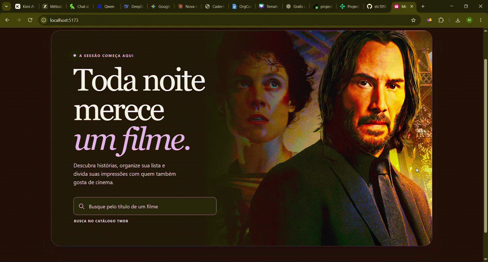

# Projeto final



## Acesso

https://projeto4miguel.netlify.app/

## Desenvolvedor(a) / Desenvolvedor(es/as)
- [Miguel Miron Silva](misilva@inf.ufsm.br)
- [E-Mail Pessoal](miguelmironsilva@gmail.com)


## Proposta
 Completar o desenvolvimento do trabalho do terceiro projeto, adicionando funções que faltam (superusuário, sistema de resenhas, habilidade de deletar resenhas/usuários). Além disso, implementar:


1) Containeirizar frontend e backend com o docker

2) Implementação de login com Google e/ou GitHub via OAuth2/OIDC 

3) API de IA (preferencialmente Gemini): Extrair todas as resenhas de um filme e retornar um resumo delas


## Desenvolvimento

### Processo

**Semana 1 (04/11/26 - 08/11/26)** 
- Compleção do modelo de superusuário e adoção da ferramenta de migração Alembic para atualizar as tabelas com o superusuário, a partir de sugestões do GPT 6.1 Sol. Isso faz possível a adição de novas tabelas preservando os dados, e adicionando flags que sinalizam que um usuário é superusuário. Várias pequenas correções feitas
- Implementação do superusuário no frontend e no backend de maneira definitiva. Contas de superusuário podem ser criadas localmente "por fora", com o backend cuidando da autenticação do superusuário e o frontend exibindo funcionalidades extras (área administrativa) para o superusuário.

**Semana 2 (09/11/26 - 15/11/26)** 
- Implementação das resenhas, ligadas ao autor e a ID do filme. Cada usuário autenticado pode publicar uma avaliação por filme, com nota de 0 a 10, texto de até 2.000 caracteres ou ambos, e pode editar ou excluir a própria publicação. Visitantes podem consultar as avaliações. Favoritos e marcações de filmes assistidos continuam privados e independentes das avaliações. Notas antigas transferidas para o novo formato. Inspirado pelo Western Reels de Rafael Klaue.
- Sistema de superusuário combinado com o de resenhas: Superusuários podem moderar resenhas excluindo-as.
- Exclusão de contas adicionada. Superusuários podem excluir outras contas, apagando todos os seus outros dados (resenhas, filmes favoritos, etc) junto.
- Correções aplicadas ao formulário de autenticação (confirmação da senha pedida, visualização da senha), cálculo da nota da comunidade a partir das notas das resenhas.
- Autoexclusão das contas adicionada, pedindo a senha para excluir e excluindo tudo do usuário. O último superusuário é proibido de se autoexcluir.

**Semana 3 (16/11/26 - 23/11/26)** 
- Melhoras na interface: Adição de lista de visualização de resenhas pessoais e lista de filmes que desejo assistir. Superusuários podem promover usuários à superusuários na área administrativa.
- Implementação da autenticação via Google API, com OAuth 2.0, inspirado no [exemplo passado na aula](https://github.com/elc1090/demo-auth-profile). O backend valida a identidade no Google e usa um código de uso único para iniciar uma sessão com o JWT da própria aplicação. No primeiro acesso, o sistema cria uma conta comum sem senha local e usa o identificador do Google para reconhecê-la nos acessos seguintes. Se o e-mail já estiver cadastrado, o login informa o conflito e preserva a conta existente. Contas criadas pelo Google precisam solicitar a exclusão à administração.
- Implementação do sumário de resenhas através de IA. Chave de API do Gemini gerada para o projeto, com o modelo Gemini-3.5-flash-lite sendo escolhido para ser usado. Usuários autenticados podem acionar o recurso quando há resenhas escritas, e a interface avisa que os textos serão enviados ao Google e exibe o resultado identificado como gerado por IA, com a contagem de resenhas analisadas. O backend envia apenas os textos e orienta o Gemini a destacar elogios, críticas e divergências, evitando spoilers. Avaliações sem texto continuam compondo a nota da comunidade, e a edição, publicação ou exclusão de uma avaliação na mesma tela remove o resumo anterior.
- Contaneirização do Backend, seguindo os [exemplos em aula](https://github.com/elc1090/demo-backend-auth) de número 2, 5 e 6. Prisma/Node substituido por Alembic/Uvicorn, e o Dockerfile Node/Express pelo Dockerfile Python (presente no exemplo 2). Docker e Docker Compose usados, compose.yaml reaproveitado para publicar a API. Um volume novo recebe um banco vazio, preservando o banco local.
- Contaneirização do Frontend, integrando também o exemplo de número 9, sem o supabase. Com o Node 24 gerando o bundle de produção, e o Nginx servindo os arquivos estáticos. Contexto de build do frontend integrando ao compose.yaml.
- Frontend refatorado.

### Trechos de código

**Deleção de resenha:**

````
@router.delete("/{review_id}", status_code=status.HTTP_204_NO_CONTENT)
def delete_review(tmdb_id: SQLiteId, review_id: SQLiteId, db: Database, current_user: CurrentUser):
    """Remove a resenha (nota e texto) como autor ou superusuário."""
    review = _find_review(db, tmdb_id, review_id)
    if review.user_id != current_user.id and not current_user.is_superuser:
        raise HTTPException(status.HTTP_403_FORBIDDEN, "Apenas o autor ou um superusuário pode excluir esta resenha")
    db.delete(review)
    db.commit()
    return Response(status_code=status.HTTP_204_NO_CONTENT)
````
Só o usuário logado ``current_user`` ou um  superusuário ``superuser`` podem deletar avaliações de filmes.

**Login no Google:**

````
def consume_attempt(db: Session, state: str, browser_secret: str):
    result = db.execute(delete(GoogleLoginAttempt).where(
        GoogleLoginAttempt.state_hash == digest(state),
        GoogleLoginAttempt.browser_hash == digest(browser_secret),
        GoogleLoginAttempt.expires_at > int(time.time()),
    ).returning(
        GoogleLoginAttempt.nonce, GoogleLoginAttempt.google_verifier,
        GoogleLoginAttempt.frontend_challenge,
    )).one_or_none()
    db.commit()
    return result
````
Essa função valida e consome uma tentativa de login com Google quando o navegador retorna ao backend. Ela só encontra a tentativa se o ``state`` recebido do Google corresponder ao registrado no início do login, o segredo do cookie corresponder ao do navegador que iniciou o fluxo e o prazo ainda estiver válido.

O ``delete`` e o ``returning`` apagam a tentativa e devolvem, na mesma operação, os dados necessários para continuar o login. O ``nonce`` é usado para conferir o token do Google, o ``google_verifier`` para trocar o código de autorização com Proof Key for Code Exchange que vincula o código de autorização a quem iniciou o login, e o ``frontend_challenge`` para vincular a etapa final à aba que iniciou o login.

O ``db.commit()`` confirma a exclusão, garantindo que a tentativa seja usada uma única vez. Se nenhuma linha atender às três condições, a função retorna None.


**Resumo com Gemini:**
````
@router.post("/summary", response_model=ReviewSummaryResponse)
def summarize_reviews(tmdb_id: SQLiteId, db: Database, _current_user: CurrentUser):
    rows = db.scalars(
        select(Review.text)
        .where(Review.tmdb_id == tmdb_id, Review.text.is_not(None))
        .order_by(Review.id)
    ).all()
    texts = [text for text in rows if text and text.strip()]
````
A consulta lê apenas a coluna de texto das resenhas daquele filme. A última linha descarta textos vazios, deixando para o Gemini apenas as opiniões escritas. Notas e dados dos autores ficam fora do envio.

## Tecnologias

### Linguagens e afins

Backend
- Linguagem: [Python](https://docs.python.org/3/)
- Framework: [FastAPI](https://devdocs.io/fastapi/) 
- Banco de dados: [SQLite](https://devdocs.io/sqlite/) + [SQLAlchemy](https://docs.sqlalchemy.org/en/20/)
- Servidor web local: [Uvicorn](https://uvicorn.dev/)
- Migração de banco: [Alembic](https://alembic.sqlalchemy.org/en/latest/)
- Hospedagem: [Render](https://render.com/)

Frontend
- [HTML5](https://devdocs.io/html/) + [CSS3](https://devdocs.io/css/) + [JavaScript/TypeScript](https://devdocs.io/javascript/) 
- Frameworks: [React.js](https://devdocs.io/react/) + [Vite](https://devdocs.io/vite/) 
- Servidor web do frontend para Docker: [Nginx](https://nginx.org/) + [Node.js 24](https://nodejs.org/pt-br/blog/release/v24.0.0)
- Hospedagem: [Netlify](https://app.netlify.com/)


### Ambiente de desenvolvimento

- [Git](https://git-scm.com/)
- [Sublime Text Editor](https://www.sublimetext.com/)
- [Docker Desktop](https://www.docker.com)
- IA usada para planejamento, tirada de dúvidas e debugging: [GPT-6.1 Sol](https://openai.com)

### Guia de primeiro superusuário

O primeiro superusuário é instanciado a partir da primeira inserção de uma senha por uma conta de usuário. Primeiro, registre uma conta nova, vá ao painel de Minha Conta, e insira a senha `primeiro_codigo` no painel de `Configurar primeiro superusuário`. Feito isso, essa conta se tornará o primeiro administrador do sistema.

#### Login com Google (opcional)

No ambiente de desenvolvimento, abra o frontend em `http://localhost:5173` e use `http://127.0.0.1:8000/api/auth/google/callback` como URI de redirecionamento do cliente Web na Google Auth Platform. Configure `GOOGLE_CLIENT_ID` e `GOOGLE_CLIENT_SECRET` no ambiente do backend. Para endereços diferentes, configure `FRONTEND_URL` (origem do frontend) e `GOOGLE_REDIRECT_URI` (callback exato no Google); `VITE_API_BASE_URL` deve usar a mesma origem pública do callback, com o prefixo `/api`.

Antes de reiniciar a API, instale as dependências e aplique as migrações em `backend` com `python -m pip install -r requirements.txt` e `python -m alembic upgrade head`. Faça backup do SQLite antes de migrar um banco existente.

#### Aplicação local com Docker Compose

1. Preencha `TMDB_API_KEY` e `JWT_SECRET_KEY` no ambiente do backend. Se ainda não tiver `backend/.env`, use [o exemplo de configuração](<backend/.env.example>) como ponto de partida. Para testar o resumo por IA, configure também `GEMINI_API_KEY` e `GEMINI_MODEL`. Nenhuma dessas credenciais entra na imagem do frontend.
2. Na raiz do projeto, execute `docker compose up -d --build --wait` (ou `docker compose up --build` para acompanhar os logs). Para iniciar apenas a API, acrescente `backend` ao comando.
3. Abra <http://localhost:3000>. Os healthchecks podem ser conferidos em <http://localhost:3000/health> e <http://localhost:8000/health>. Use `localhost`, não `127.0.0.1`, para abrir o frontend no endereço padrão do Compose.
4. Para validar a integração, busque um filme, entre na aplicação, publique uma resenha de teste com texto e gere o resumo. Para testar login com Google, cadastre o callback exato `http://localhost:8000/api/auth/google/callback` no cliente OAuth e forneça `GOOGLE_CLIENT_ID` e `GOOGLE_CLIENT_SECRET` ao backend.

O [Compose](<compose.yaml>) usa `http://localhost:8000/api` no build do Vite e permite `http://localhost:3000` no FastAPI. Para trocar as portas, defina `FRONTEND_PORT` ou `BACKEND_PORT` no ambiente do Compose (shell ou `.env` **na raiz**); os endereços locais padrão acompanham essas portas. Para usar outros endereços públicos, defina explicitamente `VITE_API_BASE_URL` (com `/api`), `FRONTEND_URL` e `GOOGLE_REDIRECT_URI` nesse mesmo ambiente. O Compose define as duas URLs do backend acima dos valores de `backend/.env`. Recompile a imagem do frontend após alterar `VITE_API_BASE_URL` e atualize o callback cadastrado no Google se ele mudar.

A API migra o SQLite antes de iniciar. Com um volume novo, o banco começa vazio e o banco local não é copiado. `docker compose down` preserva o volume; `docker compose down -v` **apaga** os dados do contêiner.

## Referências e créditos

Webapp para busca de filmes - projeto original
- https://github.com/mmj030703/Movie-Search-App/
- https://movie-search-app-weld.vercel.app/

Webapp para busca de filmes, com funcionalidades adicionais
- https://github.com/elc1090/project1-2026b-gabriel-maroneze
- https://elc1090.github.io/project1-2026b-gabriel-maroneze/

Inspiração para o sistema de reviews
- https://github.com/elc1090/project2-2026b-rpklaue


---
Projeto entregue para a disciplina de [Desenvolvimento de Software para a Web](http://github.com/andreainfufsm/elc1090-2026b) em 2026b
